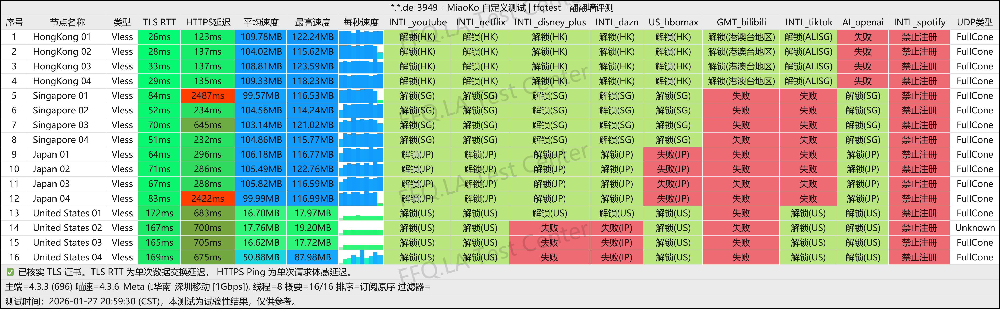
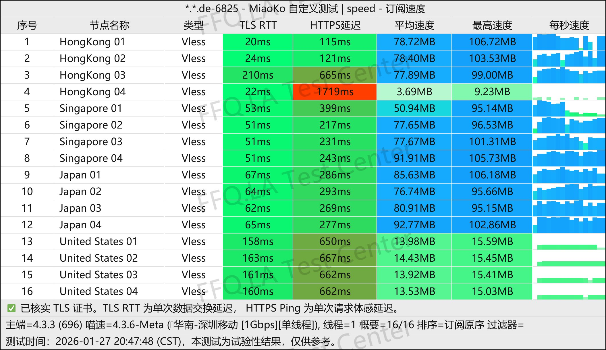
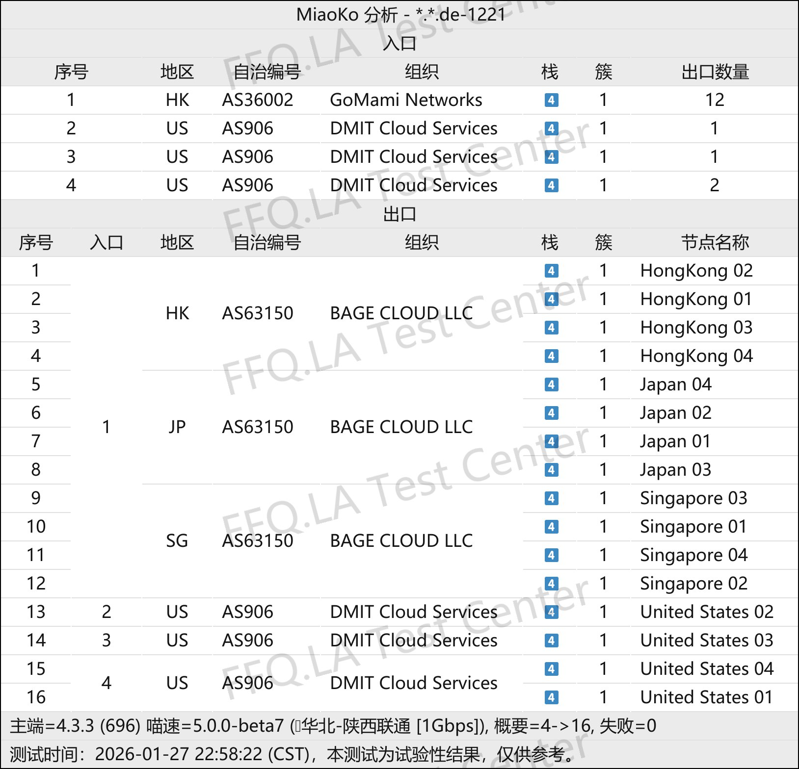

🇨🇳 [中文](README.md) | 🇺🇸 English | 🇷🇺 [Русский](README_RU.md) | 🇮🇷 [فارسی](README_FA.md)

# KenDeJi VPN Official Website (Updated November 2, 2026)

Official KenDeJi VPN Website<br>
Latest URL: [kendeji.io](https://to.iix.im/kdj01)<br>
Official URL: [kendeji.io](https://to.iix.im/kdj01)<br>

Best VPN Recommendations and Server List for 2026: [https://github.com/jdnei/JiChangTuiJian](https://github.com/jdnei/JiChangTuiJian)<br>

## Telegram VPN Deals & Community #AD
[VPN Giveaways](https://331024.de/archives/choujiang) | [VPN Chat Group](https://331024.de/archives/choujiang) | [VPN Trial Group](https://331024.de/archives/choujiang)<br>

[https://331024.de/archives/choujiang](https://331024.de/archives/choujiang)

## Invitation Code
```bash
uulD1o99
```

## Promo Code / Discount Code
`10% OFF`

```bash
MOON
```

## Overview
KenDeJi VPN is a premium VPN provider specializing in high-quality direct connections and optimized routing for China's three major internet carriers.

The service targets mid-range to high-end users who prioritize connection speed, stability during evening peak hours, and reliable access to streaming platforms and AI services.

According to publicly available information, KenDeJi primarily uses optimized network routes, including CN2 GIA for China Telecom, 9929/10099 for China Unicom, and CMIN2 for China Mobile. It also supports modern protocols such as VLESS and AnyTLS.

Reports differ slightly regarding its launch date. Some sources indicate that the service began operating in 2025, while community records suggest it was officially established on January 8, 2026.

## Advantages

**Optimized Routing for Three Major Carriers:** KenDeJi uses high-quality entry points and backbone routes optimized separately for China Telecom, China Unicom, and China Mobile. Compared with ordinary public-internet direct connections, these routes generally offer lower latency, reduced packet loss, and better performance during evening peak hours.<br>

**High Connection Speeds:** Public speed tests and service descriptions indicate that some servers provide substantial bandwidth, making them suitable for HD video streaming, downloads, and large file transfers.<br>

**Comprehensive Streaming Unblocking:** Third-party tests suggest that most servers support major streaming platforms, including Netflix, Disney+, and YouTube Premium, as well as region-restricted services such as TikTok.<br>

**Strong AI Service Support:** KenDeJi provides servers designed to access AI services such as ChatGPT. Some sources also mention dedicated AI and Codex servers.<br>

**Modern Protocol Support:** The service supports VLESS and AnyTLS and is compatible with popular clients such as Clash-based applications, Shadowrocket, Stash, and sing-box. However, actual compatibility depends on the specific protocol and client version.<br>

**Flexible Multi-Device Usage:** Some public descriptions highlight support for multiple devices and relatively relaxed connection limits, making the service convenient for simultaneous use on smartphones, computers, and tablets.<br>

**Overall Assessment:** KenDeJi's main selling points are not low prices or extremely large data allowances, but premium direct connections optimized for all three major Chinese carriers, high speeds, and strong content-unblocking capabilities.

It is particularly suitable for users who value network quality, streaming access, AI services, and stable performance during evening peak hours.

The main disadvantages are its relatively high prices compared with ordinary direct-connection VPN services and its limited operating history, meaning long-term reliability still requires observation.

Third-party service-status aggregators indicated that KenDeJi was operating normally as of August 2026.<br>

## Pricing Plans

| Plan | Price | Monthly Data | Connection Speed | Concurrent IP Connections |
| --- | ---: | ---: | ---: | ---: |
| Small Napoleon Cake | ¥60.00 / 2 Months | 75 GB/month | 1.50 Gbps | Unlimited |
| Dudu Cake | ¥40.00/month | 100 GB/month | 2.00 Gbps | Unlimited |
| Large Dudu Cake | ¥60.00/month | 150 GB/month | 2.00 Gbps | Unlimited |
| Two Dudu Cakes | ¥80.00/month | 200 GB/month | 2.00 Gbps | Unlimited |
| Two and a Half Dudu Cakes | ¥100.00/month | 250 GB/month | 2.00 Gbps | Unlimited |
| Scone | ¥200.00/month | 500 GB/month | Unlimited | Unlimited |
| Soufflé | ¥350.00/month | 1 TB/month | Unlimited | Unlimited |

## 📊 Performance Tests & Analysis

#### 1. Evening Peak-Hour Speed Test
<br>

#### 2. Streaming Service Unblocking Report
<br>

#### 3. Entry and Exit Node Analysis
<br>
