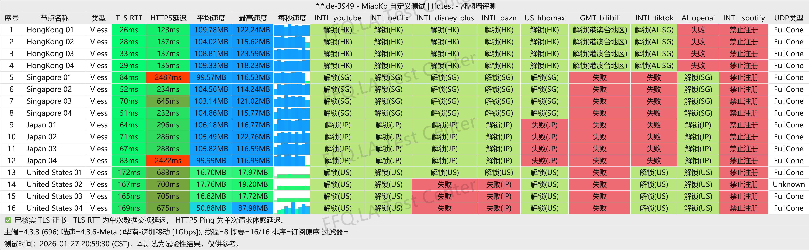
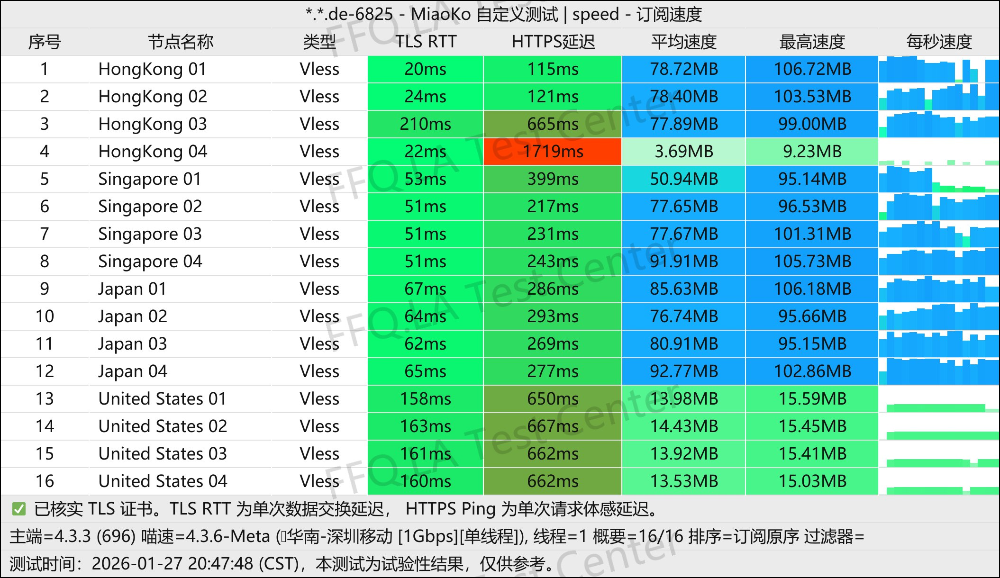
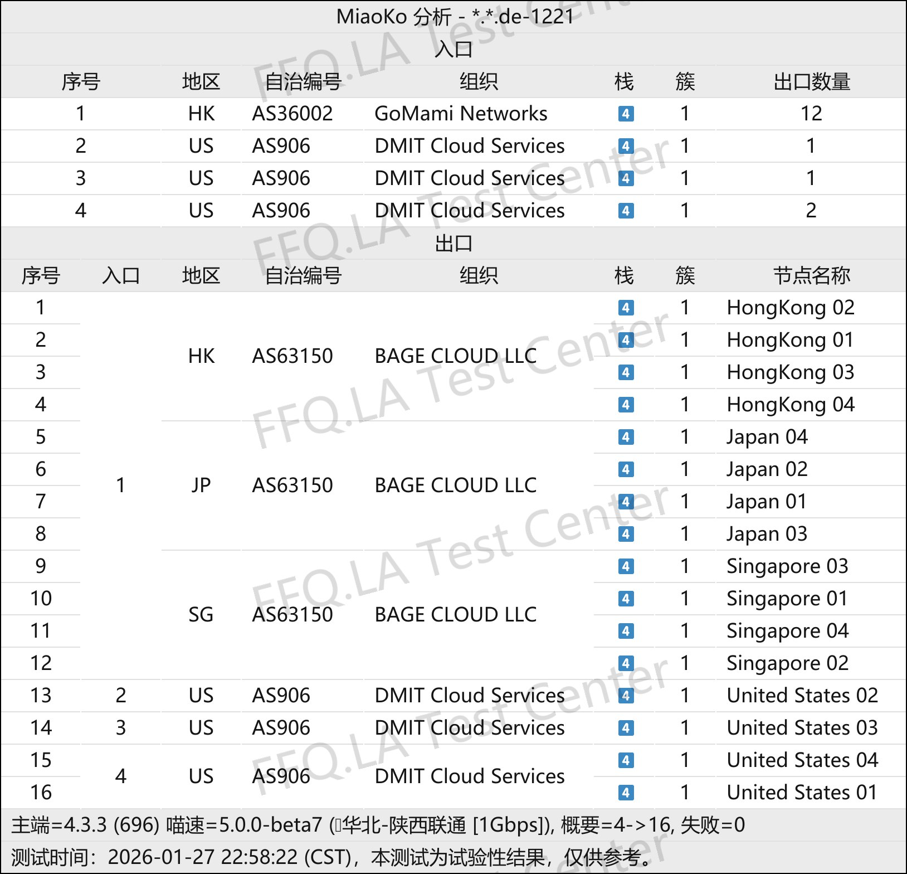

 🇨🇳 [中文](README.md) | 🇺🇸 [English](README_EN.md) | 🇷🇺 [Русский](README_RU.md) | 🇮🇷 فارسی

# وب‌سایت رسمی KenDeJi VPN (به‌روزرسانی 7 نوامبر 2026)
وب‌سایت رسمی KenDeJi VPN<br>
آخرین آدرس: [kendeji.io](https://to.iix.im/kdj01)<br>
آدرس رسمی: [kendeji.io](https://to.iix.im/kdj01)<br>

معرفی بهترین سرویس‌ها و سرورهای VPN در سال ۲۰۲۶: [https://github.com/jdnei/JiChangTuiJian](https://github.com/jdnei/JiChangTuiJian)<br>

## انجمن و پیشنهادهای ویژه VPN در تلگرام #AD
[قرعه‌کشی VPN](https://331024.de/archives/choujiang) | [گروه گفت‌وگوی VPN](https://331024.de/archives/choujiang) | [گروه آزمایش VPN](https://331024.de/archives/choujiang)<br>

[https://331024.de/archives/choujiang](https://331024.de/archives/choujiang)

## کد دعوت
```bash
uulD1o99
```

## کد تخفیف
`۱۰٪ تخفیف`

```bash
MOON
```

## معرفی
KenDeJi VPN یک ارائه‌دهنده خدمات VPN در رده متوسط تا پیشرفته است که بر اتصالات مستقیم باکیفیت و مسیرهای ارتباطی بهینه‌شده برای سه اپراتور بزرگ اینترنت چین تمرکز دارد.

این سرویس عمدتاً برای کاربرانی طراحی شده است که به سرعت بالا، پایداری اتصال در ساعات اوج مصرف شبانه و دسترسی باکیفیت به پلتفرم‌های پخش آنلاین و خدمات هوش مصنوعی اهمیت می‌دهند.

بر اساس اطلاعات عمومی موجود، KenDeJi عمدتاً از مسیرهای شبکه بهینه‌شده شامل CN2 GIA برای China Telecom، مسیرهای 9929/10099 برای China Unicom و CMIN2 برای China Mobile استفاده می‌کند. همچنین از پروتکل‌های جدید VLESS و AnyTLS پشتیبانی می‌کند.

اطلاعات مربوط به تاریخ شروع فعالیت این سرویس کمی متفاوت است. برخی منابع آغاز فعالیت آن را سال ۲۰۲۵ اعلام کرده‌اند، در حالی که برخی سوابق انجمن‌های تخصصی نشان می‌دهند که این سرویس به‌طور رسمی در ۸ ژانویه ۲۰۲۶ تأسیس شده است.

## مزایا

**بهینه‌سازی برای سه اپراتور اصلی چین:** KenDeJi از نقاط ورودی و مسیرهای اصلی شبکه باکیفیت استفاده می‌کند که به‌طور جداگانه برای China Telecom، China Unicom و China Mobile بهینه‌سازی شده‌اند. در مقایسه با اتصالات مستقیم معمولی از طریق اینترنت عمومی، این مسیرها معمولاً تأخیر کمتر، افت بسته پایین‌تر و عملکرد پایدارتری در ساعات اوج مصرف شبانه دارند.<br>

**سرعت اتصال بالا:** برخی آزمایش‌های عمومی سرعت و توضیحات منتشرشده درباره سرویس نشان می‌دهند که تعدادی از سرورها پهنای باند بالایی ارائه می‌کنند. این ویژگی آن‌ها را برای تماشای ویدئوهای باکیفیت، دانلود و انتقال فایل‌های حجیم مناسب می‌سازد.<br>

**پشتیبانی گسترده از رفع محدودیت سرویس‌های پخش آنلاین:** آزمایش‌های شخص ثالث نشان می‌دهند که بیشتر سرورها از پلتفرم‌های محبوبی مانند Netflix، Disney+ و YouTube Premium پشتیبانی می‌کنند. همچنین امکان دسترسی به سرویس‌های دارای محدودیت منطقه‌ای مانند TikTok فراهم است.<br>

**پشتیبانی مناسب از خدمات هوش مصنوعی:** KenDeJi سرورهای ویژه‌ای برای دسترسی به خدمات هوش مصنوعی مانند ChatGPT ارائه می‌دهد. برخی منابع همچنین به وجود سرورهای اختصاصی AI و Codex اشاره کرده‌اند.<br>

**پروتکل‌های مدرن:** این سرویس از VLESS و AnyTLS پشتیبانی می‌کند و با کلاینت‌های محبوب مانند برنامه‌های مبتنی بر Clash، Shadowrocket، Stash و sing-box سازگار است. البته سازگاری واقعی به نوع پروتکل و نسخه کلاینت بستگی دارد.<br>

**استفاده انعطاف‌پذیر از چندین دستگاه:** برخی توضیحات عمومی سرویس بر امکان استفاده هم‌زمان از چند دستگاه و محدودیت‌های نسبتاً آسان‌گیرانه اتصال تأکید دارند. این ویژگی برای استفاده هم‌زمان از VPN روی گوشی هوشمند، رایانه و تبلت مناسب است.<br>

**ارزیابی کلی:** مهم‌ترین مزیت KenDeJi قیمت بسیار پایین یا حجم ترافیک فوق‌العاده زیاد نیست، بلکه ارائه اتصالات مستقیم باکیفیت، بهینه‌سازی‌شده برای سه اپراتور بزرگ چین، سرعت بالا و توانایی مناسب در رفع محدودیت محتوا است.

این سرویس به‌ویژه برای کاربرانی مناسب است که کیفیت شبکه، دسترسی به پلتفرم‌های پخش آنلاین، خدمات هوش مصنوعی و عملکرد پایدار در ساعات اوج مصرف شبانه را در اولویت قرار می‌دهند.

از معایب اصلی آن می‌توان به قیمت نسبتاً بالاتر در مقایسه با VPNهای معمولی با اتصال مستقیم و سابقه فعالیت نسبتاً کوتاه اشاره کرد. بنابراین پایداری بلندمدت سرویس همچنان نیازمند بررسی و نظارت است.

بر اساس داده‌های تجمیعی شخص ثالث درباره وضعیت سرویس‌ها، KenDeJi در اوت ۲۰۲۶ همچنان در وضعیت عملیاتی عادی قرار داشت.<br>

## طرح‌های اشتراک

| نام طرح | قیمت | حجم ماهانه | سرعت اتصال | تعداد اتصال هم‌زمان IP |
| --- | ---: | ---: | ---: | ---: |
| ناپلئونی کوچک | ¥60.00 / دو ماه | 75 GB/ماه | 1.50 Gbps | نامحدود |
| کیک دودو | ¥40.00/ماه | 100 GB/ماه | 2.00 Gbps | نامحدود |
| کیک بزرگ دودو | ¥60.00/ماه | 150 GB/ماه | 2.00 Gbps | نامحدود |
| دو کیک دودو | ¥80.00/ماه | 200 GB/ماه | 2.00 Gbps | نامحدود |
| دو و نیم کیک دودو | ¥100.00/ماه | 250 GB/ماه | 2.00 Gbps | نامحدود |
| اسکون | ¥200.00/ماه | 500 GB/ماه | نامحدود | نامحدود |
| سوفله | ¥350.00/ماه | 1 TB/ماه | نامحدود | نامحدود |

## 📊 آزمایش عملکرد و تحلیل

#### 1. آزمایش سرعت در ساعات اوج مصرف شبانه
<br>

#### 2. گزارش رفع محدودیت سرویس‌های پخش آنلاین
<br>

#### 3. تحلیل سرورهای ورودی و خروجی
<br>
