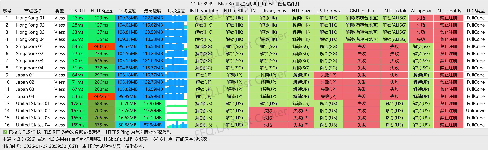
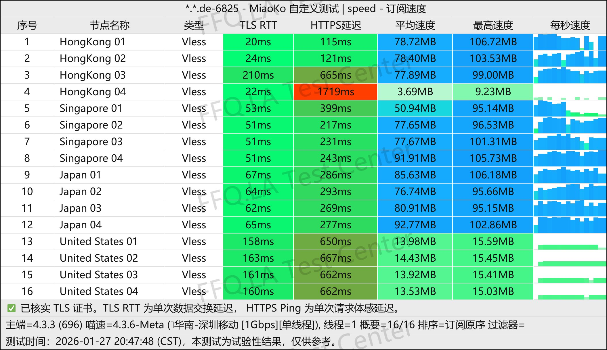
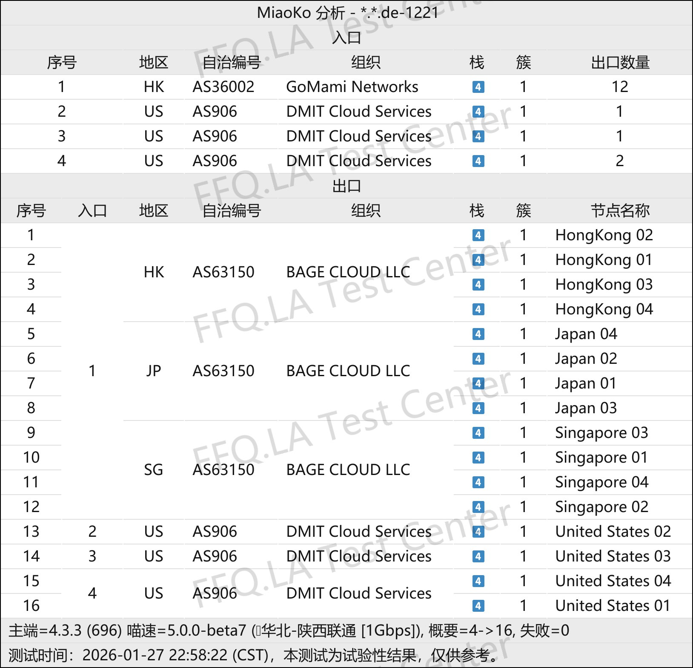

🇨🇳 [中文](README.md) | 🇺🇸 [English](README_EN.md) | 🇷🇺 Русский | 🇮🇷 [فارسی](README_FA.md)

# Официальный сайт KenDeJi VPN (обновлено 10 ноября 2026)

Официальный сайт KenDeJi VPN<br>
Актуальный адрес: [kendeji.io](https://to.iix.im/kdj01)<br>
Официальный адрес: [kendeji.io](https://to.iix.im/kdj01)<br>

Лучшие VPN-сервисы и серверы на 2026 год: [https://github.com/jdnei/JiChangTuiJian](https://github.com/jdnei/JiChangTuiJian)<br>

## Telegram: VPN-сообщество и специальные предложения #AD
[Розыгрыши VPN](https://331024.de/archives/choujiang) | [Чат о VPN](https://331024.de/archives/choujiang) | [Группа тестирования VPN](https://331024.de/archives/choujiang)<br>

[https://331024.de/archives/choujiang](https://331024.de/archives/choujiang)

## Пригласительный код
```bash
uulD1o99
```

## Промокод / Код скидки
`Скидка 10%`

```bash
MOON
```

## Обзор
KenDeJi VPN — VPN-провайдер среднего и премиального сегмента, специализирующийся на высококачественных прямых соединениях и оптимизированных маршрутах для трёх крупнейших интернет-операторов Китая.

Сервис ориентирован на пользователей, которым важны высокая скорость, стабильность соединения в вечерние часы пик, а также качественный доступ к стриминговым платформам и сервисам искусственного интеллекта.

Согласно общедоступной информации, KenDeJi использует оптимизированные сетевые маршруты, включая CN2 GIA для China Telecom, 9929/10099 для China Unicom и CMIN2 для China Mobile. Также поддерживаются современные протоколы VLESS и AnyTLS.

Сведения о дате запуска сервиса немного различаются. Некоторые источники указывают, что он начал работу в 2025 году, тогда как записи сообщества свидетельствуют об официальном основании 8 января 2026 года.

## Преимущества

**Оптимизация для трёх крупнейших операторов:** KenDeJi использует высококачественные точки входа и магистральные маршруты, отдельно оптимизированные для China Telecom, China Unicom и China Mobile. По сравнению с обычными прямыми подключениями через публичный интернет такие маршруты, как правило, обеспечивают меньшую задержку, снижение потерь пакетов и более стабильную работу в вечерние часы пик.<br>

**Высокая скорость соединения:** Общедоступные тесты и описания сервиса показывают, что некоторые серверы обладают высокой пропускной способностью. Это делает их подходящими для просмотра видео высокого разрешения, загрузки файлов и передачи больших объёмов данных.<br>

**Широкие возможности разблокировки стриминга:** Согласно сторонним тестам, большинство серверов поддерживают популярные платформы, включая Netflix, Disney+ и YouTube Premium, а также регионально ограниченные сервисы, такие как TikTok.<br>

**Хорошая поддержка AI-сервисов:** KenDeJi предоставляет специальные серверы для доступа к сервисам искусственного интеллекта, включая ChatGPT. Некоторые источники также упоминают отдельные серверы для AI и Codex.<br>

**Современные протоколы:** Сервис поддерживает VLESS и AnyTLS и совместим с популярными клиентами, включая приложения на базе Clash, Shadowrocket, Stash и sing-box. Однако фактическая совместимость зависит от используемого протокола и версии клиента.<br>

**Гибкое использование нескольких устройств:** Некоторые общедоступные описания подчёркивают поддержку нескольких устройств и относительно свободные ограничения на подключения. Это удобно для одновременного использования VPN на смартфонах, компьютерах и планшетах.<br>

**Общая оценка:** Главное преимущество KenDeJi заключается не в минимальных ценах или огромных объёмах трафика, а в качественных прямых соединениях, оптимизированных для трёх основных китайских операторов, высокой скорости и широких возможностях разблокировки контента.

Сервис особенно подходит пользователям, которые ценят качество сети, доступ к стриминговым платформам, AI-сервисам и стабильную работу в вечерние часы пик.

Основные недостатки — относительно высокая стоимость по сравнению с обычными VPN-сервисами с прямым подключением и небольшой срок работы на рынке. Поэтому долгосрочная надёжность сервиса ещё требует наблюдения.

По данным сторонних агрегаторов состояния сервисов, в августе 2026 года KenDeJi продолжал работать в штатном режиме.<br>

## Тарифные планы

| Тариф | Цена | Трафик в месяц | Скорость соединения | Одновременные IP-подключения |
| --- | ---: | ---: | ---: | ---: |
| Маленький «Наполеон» | ¥60.00 / 2 месяца | 75 ГБ/мес. | 1,50 Гбит/с | Без ограничений |
| Пирожное «Дуду» | ¥40.00/мес. | 100 ГБ/мес. | 2,00 Гбит/с | Без ограничений |
| Большое пирожное «Дуду» | ¥60.00/мес. | 150 ГБ/мес. | 2,00 Гбит/с | Без ограничений |
| Два пирожных «Дуду» | ¥80.00/мес. | 200 ГБ/мес. | 2,00 Гбит/с | Без ограничений |
| Два с половиной пирожных «Дуду» | ¥100.00/мес. | 250 ГБ/мес. | 2,00 Гбит/с | Без ограничений |
| Скон | ¥200.00/мес. | 500 ГБ/мес. | Без ограничений | Без ограничений |
| Суфле | ¥350.00/мес. | 1 ТБ/мес. | Без ограничений | Без ограничений |

## 📊 Тесты производительности и анализ

#### 1. Тест скорости в вечерние часы пик
<br>

#### 2. Отчёт о разблокировке стриминговых сервисов
<br>

#### 3. Анализ входных и выходных узлов
<br>
